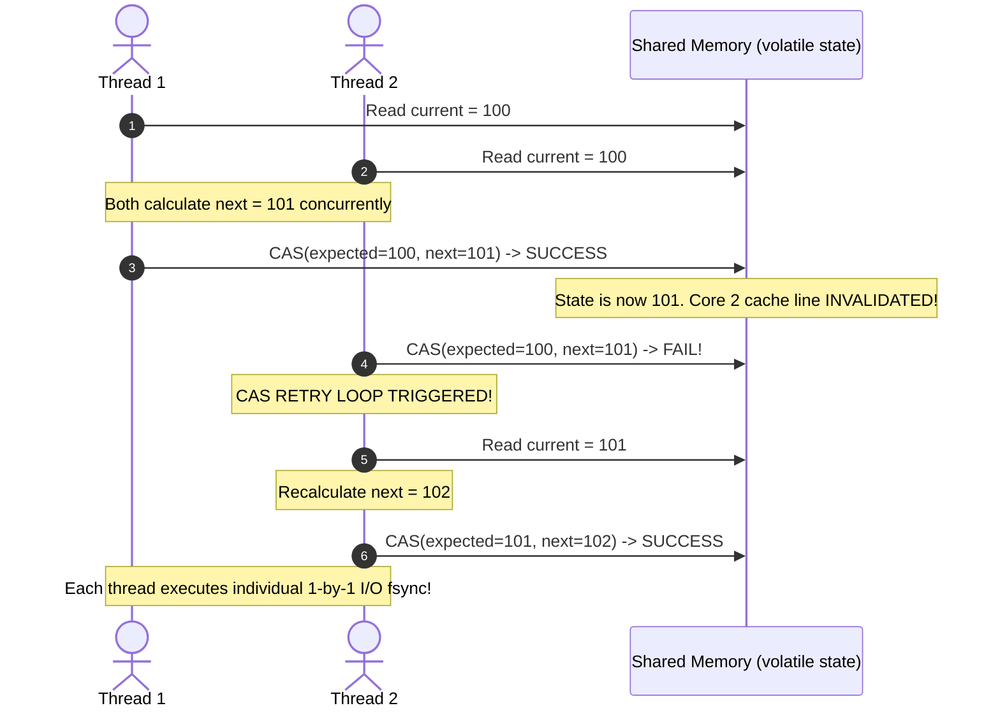
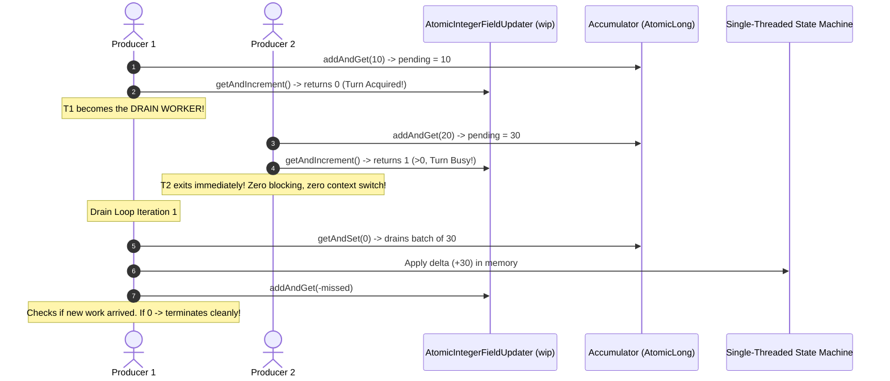
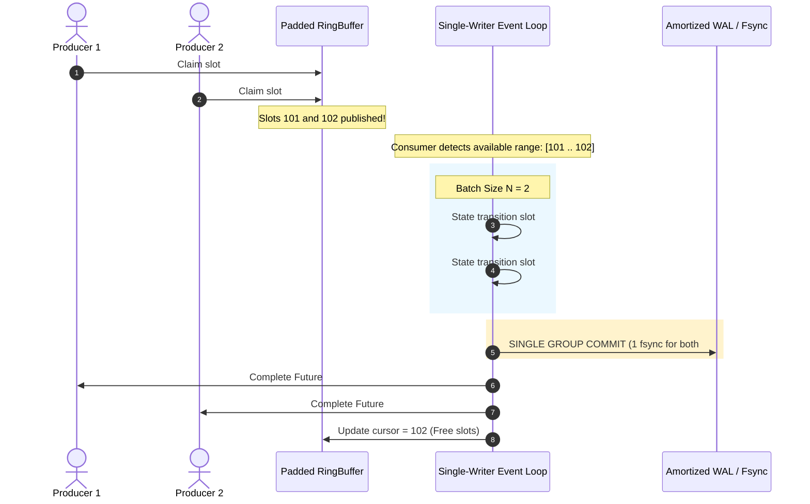
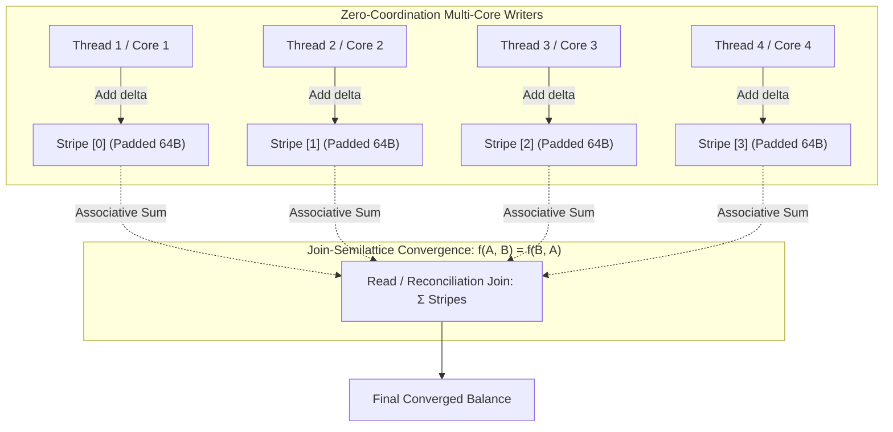

# Architectural Specification & Visual Blueprints (Archify Edition)
## Comparative Concurrency Paradigms: From CAS to Commutative State Machines

This document provides architectural blueprints, hardware cache layout diagrams, and state-machine sequence flows for the five fundamental concurrency coordination models.

---

## 1. High-Level Evolution Architecture (Archify Overview)

```
====================================================================================================
                        CONCURRENCY & STATE COORDINATION EVOLUTION SPECTRUM
====================================================================================================

  [ LEVEL 1: CAS LOOP ]         [ LEVEL 2a: ACTOR MAILBOX ]     [ LEVEL 2b: WIP DRAIN LOOP ]
  Optimistic Multi-Writer       Pessimistic Single-Writer       Cooperative Trampoline (ServiceTalk)
  -----------------------       -------------------------       ------------------------------------
  Thread 1 ──┐                  Thread 1 ──┐                    Thread 1 ──┐ (Accumulate demand)
  Thread 2 ──┼─► [CAS State]    Thread 2 ──┼─► [Queue] ──► [Actor] Thread 2 ─┼─► [WIP State] ─► [Active]
  Thread 3 ──┘ (MESI Storm)     Thread 3 ──┘   (1-by-1 worker)  Thread 3 ──┘ (Zero thread switch)
       │                                     │                               │
       ▼                                     ▼                               ▼
  Bottleneck: Cache Contention  Bottleneck: Context Switches    Bottleneck: Linear Mutex-free
  & Invalidation Storm          & 1-by-1 Disk I/O Stall         Sequential Processing

                                             │
                                             ▼
  [ LEVEL 3: SMART-BATCHING DISRUPTOR ]                         [ LEVEL 4: COMMUTATIVE CRDT ]
  Mechanical Sympathy & Group Commit                            Conflict-Free Semilattice Math
  ----------------------------------                            ------------------------------
  Thread 1 ──┐  RingBuffer (Padded 64B)   Batch Drain           Thread 1 ──► [Partition 0] ──┐
  Thread 2 ──┼─► [Slot 0][Slot 1][Slot 2] ─────────► [Single]   Thread 2 ──► [Partition 1] ──┼─► Converged
  Thread 3 ──┘   Pre-allocated, Zero-GC               Writer    Thread 3 ──► [Partition 2] ──┘    State
       │                                                │                    │
       ▼                                                ▼                    ▼
  1 State Transition per Batch (L1 Cache) ──► 1 Amortized Fsync   Zero-Coordination Writes!
  Throughput: 10,000,000+ ops/sec              Throughput: Near-Zero Delay
====================================================================================================
```

---

## 2. Hardware Memory Layout & CPU Cache Line Alignment (64 Bytes)

In multicore architectures (x86-64 and ARM64 / Apple Silicon), the L1/L2 cache operates in **64-byte cache lines**.

### 2.1 The False Sharing Trap in Unpadded Queues & Atomic Fields

```
+---------------------------------------------------------------------------------------+
|                              CPU L1 CACHE LINE (64 BYTES)                             |
|                                                                                       |
|  [ Object Header ] [ Producer claimSequence (8B) ] [ Consumer cursor (8B) ] [ Free ]  |
|       (16B)                   (WRITTEN BY CORE 1)     (WRITTEN BY CORE 2)     (32B)   |
+---------------------------------------------------------------------------------------+
        ▲                                                       ▲
        │ Core 1 writes claimSequence                           │ Core 2 writes cursor
        │ (Issues MESI Invalidate)                              │ (Issues MESI Invalidate)
        ▼                                                       ▼
=========================================================================================
  MESI CACHE BOUNCING STORM:
  Core 1 updates claimSequence -> Marks L1 Cache Line in Core 2 INVALID (I)
  Core 2 updates cursor        -> Marks L1 Cache Line in Core 1 INVALID (I)
  Result: 100x slowdown due to constant inter-core L3 / QPI / Interconnect bus transactions!
=========================================================================================
```

### 2.2 Cache-Line Padding Solution (64-Byte Alignment in Java 8)

```
Cache Line 0 (64 Bytes):
+---------------------------------------------------------------------------------------+
| [Header 16B] | [p1..p6 Padding: 48B]                                                 |
+---------------------------------------------------------------------------------------+

Cache Line 1 (64 Bytes) - DEDICATED TO PRODUCERS:
+---------------------------------------------------------------------------------------+
| [p7 Padding: 8B] | [ volatile long claimSequence: 8B ] | [p8..p13 Padding: 48B]       |
+---------------------------------------------------------------------------------------+
                               ▲ Core 1 updates here without invalidating Cache Line 2

Cache Line 2 (64 Bytes) - DEDICATED TO CONSUMER:
+---------------------------------------------------------------------------------------+
| [p14 Padding: 8B] | [ volatile long cursor: 8B ] | [p15..p20 Padding: 48B]           |
+---------------------------------------------------------------------------------------+
                               ▲ Core 2 updates here without invalidating Cache Line 1
```

---

## 3. Sequence Flows & State Transition Mechanics

### 3.1 Level 1: CAS Loop (Optimistic Concurrency Control)



---

### 3.2 Level 2b: ServiceTalk `SequentialSubscription` / WIP Trampoline Flow



---

### 3.3 Level 3: Smart-Batching Single-Writer (Disruptor / TigerBeetle)



---

### 3.4 Level 4: Commutative CRDT (Join-Semilattice)



---

## 4. Analytical Comparison Table

| Architecture Pillar | CAS Loop (Level 1) | Actor Mailbox (Level 2a) | WIP Drain Loop (Level 2b) | Smart-Batching (Level 3) | Commutative CRDT (Level 4) |
|---|---|---|---|---|---|
| **Coordination Type** | Optimistic Multi-Writer | Pessimistic Single-Writer | Cooperative Trampoline | Pipelined Single-Writer | Math-driven (Semilattice) |
| **Hardware Contention** | Severe (MESI Invalidation) | High (Queue Head/Tail CAS) | Low (Cooperative Hand-off) | Zero (Cache Padded Ring) | Zero (Partition Striping) |
| **Thread Context Switches** | 0 (Busy spin) | 2 per message (Producer/Actor) | 0 (Calling thread drains) | Minimal (Dedicated Core) | 0 (Calling thread mutates) |
| **Object Allocation** | Zero | 1 Command object/msg | Minimal (Queue reference) | Zero (Preallocated slots) | Zero |
| **I/O Amortization** | $1 \times \text{I/O}$ per op | $1 \times \text{I/O}$ per op | 1 I/O per cooperative turn | **1 Group Commit for N ops** | Partitioned async flush |
| **Scalability Limit** | Contention collapse at $>8$ cores | Queue & I/O throughput ceiling | Linear lock-free drain limit | **Hardware memory bus bandwidth** | **Near-Infinite (Embarrassingly parallel)** |
